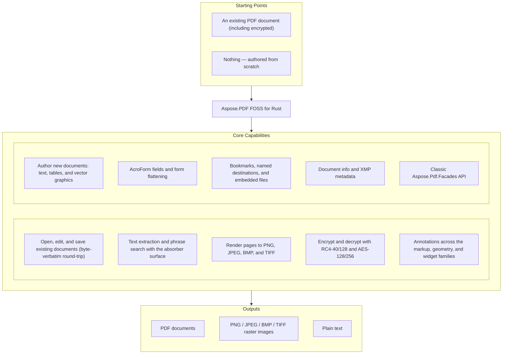

# Aspose.PDF FOSS for Rust

[](https://github.com/aspose-pdf-foss/Aspose.PDF-FOSS-for-Rust/actions/workflows/ci.yml) [](https://opensource.org/licenses/MIT) [](https://www.rust-lang.org/) [](https://doc.rust-lang.org/edition-guide/rust-2021/index.html)

[](https://github.com/aspose-pdf-foss/Aspose.PDF-FOSS-for-Rust)

Aspose.PDF FOSS for Rust is a free, open-source library for working with PDF documents —
opening and saving existing files, extracting text, rasterising pages to image formats, and
building documents from scratch (text, tables, vector graphics, watermarks, annotations,
AcroForm fields, and bookmarks). It links against nothing but the Rust standard library:
`[dependencies]` and `[dev-dependencies]` are both empty, and every primitive — the inflate,
LZW, CCITT, JBIG2 and DCT codecs, the PNG, BMP and TIFF encoders, the CFF and TrueType
parsers, the page rasteriser and the crypto stack — is implemented from its specification
rather than delegated to a crate. Its public API is a strict subset of the commercial
[Aspose.PDF](https://products.aspose.com/pdf/) for .NET library — class names, method names
and shapes mirror it where natural for migrants, with methods adapted to Rust idiom
(`snake_case` methods, `PascalCase` types) — and spec references throughout follow
ISO 32000-1 (PDF 1.7) and ISO 32000-2 (PDF 2.0).

## Navigation

- [At a Glance](#at-a-glance)
- [Key Capabilities](#key-capabilities)
- [Installation](#installation)
- [Dependencies](#dependencies)
- [Quick Start](#quick-start)
- [Additional Examples](#additional-examples)
- [Project Structure](#project-structure)
- [API Reference](#api-reference)
- [Documentation & Resources](#documentation--resources)
- [Scope and Limitations](#scope-and-limitations)
- [Development and Testing](#development-and-testing)
- [Third-Party Notices](#third-party-notices)
- [License](#license)

## At a Glance



## Key Capabilities

- **Read and write PDF** — open existing PDFs and save with a full byte-verbatim round-trip; an edit to `/Info` metadata is flushed as an incremental update (ISO 32000-1 §7.5.6), so the untouched part of the file is preserved byte for byte.
- **Text extraction and search** — `TextAbsorber` walking a `Document` or a single `Page`; `TextFragmentAbsorber` locating a phrase with its rectangle, scoped to a region or to the visible page.
- **Text writing** — positioned runs carrying the font, size and fill colour, character and word spacing, horizontal scaling, invisible text, a stroked outline, a baseline shift for sub- and superscript, and underline / strike-out rules drawn at the position and thickness the Standard-14 metrics state.
- **Rendering** — page-to-image through `PngDevice`, `JpegDevice`, `BmpDevice` and `TiffDevice` (single- and multi-page), plus `TextDevice`; TIFF output covers 1, 4, 8 and 24 bpp with median-cut palette quantisation.
- **Renderer coverage** — fills and strokes with dash patterns, rectangular clipping, constant alpha (`/ca`, `/CA`), Form XObjects and the annotation appearance streams built on them, axial and radial shadings both as `sh` and as pattern fills, tiling patterns, and images from JPEG, from raw samples (Flate / LZW / uncompressed) and from inline `BI` / `ID` / `EI` data, in grey, RGB, CMYK and ICC-based colour, honouring `/SMask` soft masks and `/Mask` stencils.
- **Text rendering** — embedded TrueType, the Standard-14 substitutes, composite Type0 / CID fonts with `/CIDToGIDMap` and `/W` metrics, and Type3 fonts whose glyph procedures execute like nested forms.
- **Font substitution** — *any* simple font with no embedded program paints: the `/BaseFont` name is mapped onto the nearest of the twelve resolvable Standard-14 faces by family, weight and slope, with the `/FontDescriptor` serif bit deciding a name that names no family, so a document's `/Arial` or `/Verdana` renders in a metric class rather than coming out blank. Platform fonts are probed first, then the bundled Liberation faces.
- **Pluggable palette quantisation** — implement the index-bitmap-converter trait and pass it to a `TiffDevice` constructor for caller-controlled palette generation.
- **Annotations** — the markup, geometry, printer-mark and widget families with their appearance, state and flag types, written with the entries §12.5.2 and §12.5.6 give them: the colour and flags, the border with its style, dash and cloudy effect, the markup author and opacity, and the entry that gives each type its shape — an ink annotation's `/InkList`, a line's `/L` and the rest of its Table 177, a polygon's `/Vertices` and intent, a text-markup annotation's `/QuadPoints`, a free text annotation's required `/DA`, a file attachment's required `/FS`, a link's or a widget's `/A` action, and the §12.9 `/Measure` dictionary a dimension line, polygon or polyline is measured against, down to the per-axis `/NumberFormat` entries. The two dates — `/M` and a markup annotation's `/CreationDate` — are written when they are given and omitted when they are not, so nothing is stamped with a time the caller never stated. An annotation loaded from a document keeps the entries this model does not name, so rewriting a page does not strip them.
- **Forms** — AcroForm field types (text, checkbox, radio, choice, list, combo, date, barcode, signature) and their appearance types, written as the merged field / widget objects §12.7.3.1 asks for: the `/Ff` flags each type is defined by (DoNotSpellCheck included, with Table 230's restriction to an editable combo box), a choice field's `/Opt` options and both halves of a selection — the `/V` value a viewer displays and the `/I` indices it was chosen by — a text field's `/MaxLen` and comb cells, the `/MK` captions and check-box mark, `/DA`, `/BS`, the user-facing and export names, and the action a field runs. `FormEditor` configures a field by name and `Form::flatten` drops the form structurally.
- **Creation** — a document built from nothing: `Document::new`, appended or inserted pages, and content authored onto them through `Page::paragraphs` (text fragments, tables, drawings), `TextBuilder`, `Page::artifacts`, annotations, form fields, bookmarks and attachments. `Page::add_image` places an image and draws it.
- **Encryption** — RC4-40, RC4-128, AES-128 and AES-256 (security-handler revisions 2, 3, 4 and 6), read and write.
- **Attachments** — embed a file into the document's `/Names /EmbeddedFiles` with its description, MIME type, associated-file relationship and file system, and read the bytes back out through `PdfExtractor`, undoing a Flate, LZW, ASCII85 or ASCIIHex filter chain.
- **Document metadata** — `DocumentInfo` typed accessors with custom-key add / remove / clear, and XMP read and written through `Metadata`.
- **Image placement** — an absorber reporting where each image is drawn on a page, with its matrix, rectangle, rotation, effective resolution and compositing state.
- **Charset codec** — an `Encoding` type (utf-8, utf-16-le, utf-16-be, latin-1, windows-1252) standing in for the canonical library's platform encoding type, authored from its contract.
- **Facades** — the task-oriented layer: `PdfFileEditor`, `PdfFileSecurity`, `PdfFileSignature`, `FormEditor`, `PdfAnnotationEditor`, `PdfBookmarkEditor`, `PdfExtractor`, `PdfPageEditor`, `PdfFileInfo`, `PdfXmpMetadata`, `PdfFileStamp`, `PdfContentEditor` and `PdfConverter`.
- **No dependencies, and no `unsafe`** — the crate is built with `#![forbid(unsafe_code)]`, so a memory-safety defect cannot become undefined behaviour.

Part of the public surface ships without being wired to the engine; those methods panic rather
than report a quiet success, and the renderer leaves some constructs unpainted. Both sets are
enumerated under [Scope and Limitations](#scope-and-limitations) — read it before planning
against this crate.

## Installation

```toml
# Cargo.toml
[dependencies]
aspose-pdf-foss = "1.26"
```

Releases are numbered `1.YY.MM` — the major pinned at `1`, the minor the release year, the
patch the release month — at a cadence of one release a month. Every `1.x` is
semver-compatible and the public surface only grows, so Cargo may upgrade a `"1.26"`
requirement to a later year without breaking a caller. See [CHANGELOG.md](CHANGELOG.md) for
the shipping surface and the full versioning policy.

### Build From Source

A plain clone is all that is needed: there is no submodule to initialise and no native
dependency to install.

```sh
git clone https://github.com/aspose-pdf-foss/Aspose.PDF-FOSS-for-Rust.git
cd Aspose.PDF-FOSS-for-Rust
cargo build --release
cargo test
```

## Dependencies

### Required Package Dependencies

None. `[dependencies]` in [Cargo.toml](Cargo.toml) is empty by deliberate choice: every
foundation primitive is composed from the format specification rather than wrapped around an
existing crate. The cost is real — the Rust ecosystem ships excellent codec and font crates
that would have shortened the work — and it is the point: it is what lets the crate promise a
dependency-free build and an auditable provenance for every byte it writes.

### Native and System Requirements

- Rust 1.86 or later, edition 2021. The minimum is proved by a CI job that installs that exact
  toolchain and builds and runs the whole suite against it, not asserted in metadata alone.
- No native libraries, no build scripts, no C toolchain.

### Development Dependencies

None. `[dev-dependencies]` is empty as well, so the test suite, the doctests and the examples
build with nothing fetched from the registry — `cargo test --offline` works on a clean machine.

## Quick Start

Every snippet below is compiled as a doctest, so it cannot drift from the API.

```rust,no_run
// Open a PDF and iterate pages
use aspose_pdf_foss::Document;

let doc = Document::open("input.pdf")?;
println!("Pages: {}", doc.pages().count());
for i in 1..=doc.pages().count() {
    println!("  page {}", doc.pages().get(i)?.number());
}
# Ok::<(), Box<dyn std::error::Error>>(())
```

```rust,no_run
// Render a page to PNG
use aspose_pdf_foss::{Document, PageDevice, PngDevice, Resolution};
use std::fs::File;

let doc = Document::open("input.pdf")?;
let png = PngDevice::with_resolution(Resolution::new(150)?);
let mut sink = File::create("page1.png")?;
png.process(&doc.pages().get(1)?, &mut sink)?;
# Ok::<(), Box<dyn std::error::Error>>(())
```

```rust,no_run
// Extract a document's text
use aspose_pdf_foss::{Document, TextAbsorber};

let doc = Document::open("input.pdf")?;
let mut absorber = TextAbsorber::new();
absorber.visit_document(&doc)?;
println!("{}", absorber.text());
# Ok::<(), Box<dyn std::error::Error>>(())
```

## Additional Examples

### Read and Update Document Metadata

```rust,no_run
use aspose_pdf_foss::Document;

let mut doc = Document::open("input.pdf")?;
doc.set_title("Quarterly report");

let info = doc.info_mut();
info.set_author("Reporting pipeline");
info.set_subject("Q3 figures");
info.add("Department", "Finance")?;

// Saving appends an incremental update, so the original bytes stay put.
doc.save_to("output.pdf")?;
# Ok::<(), Box<dyn std::error::Error>>(())
```

### Find Matching Text and Its Rectangle

```rust,no_run
use aspose_pdf_foss::{Document, TextFragmentAbsorber};

let doc = Document::open("input.pdf")?;
let mut absorber = TextFragmentAbsorber::with_phrase("Invoice total");
absorber.visit_document(&doc)?;

let found = absorber.text_fragments();
for i in 0..found.count() {
    if let Some(fragment) = found.get(i) {
        let r = fragment.rectangle();
        println!("{:?} at {:?}", fragment.text(), r);
    }
}
# Ok::<(), Box<dyn std::error::Error>>(())
```

### Render Every Page to a Multi-Page TIFF

```rust,no_run
use aspose_pdf_foss::{Document, DocumentDevice, Resolution, TiffDevice};
use std::fs::File;

let doc = Document::open("input.pdf")?;
let pages = doc.pages().count();
let tiff = TiffDevice::with_resolution(Resolution::new(150)?);
let mut sink = File::create("all_pages.tiff")?;
tiff.process_document_range(&doc, 1, pages, &mut sink)?;
# Ok::<(), Box<dyn std::error::Error>>(())
```

### Render a Page to an 8-bit Palettised TIFF

```rust,no_run
use aspose_pdf_foss::{
    ColorDepth, Document, PageDevice, Resolution, TiffDevice, TiffSettings,
};
use std::fs::File;

let doc = Document::open("input.pdf")?;

let mut settings = TiffSettings::new();
settings.set_depth(ColorDepth::Format8bpp);

// 256 colours chosen by median-cut quantisation.
let tiff = TiffDevice::with_resolution_and_settings(Resolution::new(150)?, settings);
let mut sink = File::create("page1_8bpp.tiff")?;
tiff.process(&doc.pages().get(1)?, &mut sink)?;
# Ok::<(), Box<dyn std::error::Error>>(())
```

### Encrypt a Document With AES-256

```rust,no_run
use aspose_pdf_foss::{CryptoAlgorithm, Document, Permissions};

let mut doc = Document::open("input.pdf")?;
doc.encrypt(
    "user-password",
    "owner-password",
    Permissions::PRINT_DOCUMENT,
    CryptoAlgorithm::Aesx256,
);

// Encryption is staged and applied on save.
doc.save_to("encrypted.pdf")?;
# Ok::<(), Box<dyn std::error::Error>>(())
```

### Inspect the Rendering-Device Surface

```rust,no_run
use aspose_pdf_foss::{BmpDevice, ImageDevice, JpegDevice, PageSize, PngDevice, Resolution};

// A device can be sized explicitly, or from a page size.
let mut png = PngDevice::with_dimensions_and_resolution(800, 600, Resolution::new(150)?);
png.set_transparent_background(true);

let jpeg = JpegDevice::with_page_size_resolution_and_quality(
    PageSize::a4(),
    Resolution::new(300)?,
    85,
);
let bmp = BmpDevice::with_page_size(PageSize::page_letter());

println!("{}x{} / {}x{} / {}x{}",
    png.width(), png.height(), jpeg.width(), jpeg.height(), bmp.width(), bmp.height());
# Ok::<(), Box<dyn std::error::Error>>(())
```

### Build a Document From Scratch

`examples/12_create_features.rs` is the full tour: it authors ten pages — a bookmarked cover,
a table of contents with dot leaders, a Standard-14 font grid with a watermark, an AcroForm,
nine annotation subtypes, an itemised table with a column-spanned total, vector graphics, a bar
chart, and a document-level attachment — then reopens the result, rasterises its vector page
and embeds that rendering back onto page 4, so the image is the library's own output.

```sh
cargo run --example 12_create_features -- showcase.pdf
cargo run --example 07_render_png -- showcase.pdf 8 page8.png
```

Twelve runnable example programs live in [`examples/`](examples/); the sample PDFs they take
live in [`pdfs/`](pdfs/).

## Project Structure

```text
├── src/
│   ├── lib.rs              # crate root + public re-exports
│   ├── public/             # public-API types, one per module
│   └── internal/           # foundation primitives (crate-private)
├── tests/
│   ├── public/             # public-API tests
│   ├── internal/           # per-primitive gate drivers
│   └── fixtures/           # fixture corpus
├── examples/               # 12 runnable programs (cargo run --example NAME)
├── pdfs/                   # sample PDFs for the examples
├── Cargo.toml
├── LICENSE                 # MIT
└── README.md
```

Public-API types under `src/public/` call directly into the foundation primitives under
`src/internal/`; the primitives never reach back into the public API. Everything public is
re-exported at the crate root, so a caller writes `use aspose_pdf_foss::Document` and never
names an inner module.

## API Reference

The public API is re-exported at the crate root — 308 types in all: 186 structs, 99 enums and
23 traits — centred on `Document`, opened with `Document::open` / `Document::open_with_password`
or created with `Document::new`, and written with `Document::save_to` /
`Document::save_to_writer`. `Document::pages()` returns a 1-based `PageCollection`, matching the
canonical API rather than Rust's 0-based convention, and saving an opened document appends an
incremental update instead of rewriting the file. Rendering is a trait surface: `PageDevice` for
one page, `DocumentDevice` for a range, `ImageDevice` for the raster-sizing accessors the image
devices share — so a device is chosen by the trait it implements, not by a format enum.

<details>
<summary>View the Full Core API Surface</summary>

### Core API

| Type | Kind | Description |
|---|---|---|
| `AFRelationship` | enum | Associated-file relationship (`/AFRelationship` in PDF 2.0). |
| `ActivationEvent` | enum | When a `RichMediaAnnotation` activates. |
| `Algorithm` | enum | A document-encryption cipher family. |
| `AlignmentType` | struct | A named horizontal-alignment constant. |
| `Annotation` | trait | A PDF annotation. |
| `AnnotationCollection` | struct | A page's collection of annotations (0-based indexing). |
| `AnnotationFlags` | enum | `AnnotationFlags` — see the canonical Aspose.PDF documentation. |
| `AnnotationSelector` | struct | A visitor that records the annotations it visits. |
| `AnnotationState` | enum | `AnnotationState` — see the canonical Aspose.PDF documentation. |
| `AnnotationStateModel` | enum | `AnnotationStateModel` — see the canonical Aspose.PDF documentation. |
| `AnnotationType` | enum | `AnnotationType` — see the canonical Aspose.PDF documentation. |
| `Artifact` | struct | A page artifact. |
| `ArtifactCollection` | struct | An ordered, 1-based collection of `Artifact`s. |
| `ArtifactSubtype` | enum | The subtype of a page `Artifact`. |
| `ArtifactType` | enum | The type class of a page `Artifact`. |
| `AutoRotateMode` | enum | A page auto-rotation mode. |
| `BarcodeField` | struct | A barcode text-box form field. |
| `BaseParagraph` | trait | The layout geometry common to paragraph types. |
| `BitmapInfo` | struct | Packed raster image carrier. |
| `BleedMarkAnnotation` | struct | A bleed corner printer mark. |
| `BlendMode` | enum | The blend mode used when compositing content onto a page. |
| `BlendingColorSpace` | enum | A transparency blending colour space. |
| `BmpDevice` | struct | Concrete `ImageDevice` emitting uncompressed BMP bytes. |
| `Bookmark` | struct | A bookmark (outline entry) descriptor. |
| `Bookmarks` | struct | An ordered, 0-indexed list of `Bookmark`s. |
| `Border` | struct | An annotation border (the `/BS` / `/Border` entry). |
| `BorderEffect` | enum | `BorderEffect` — see the canonical Aspose.PDF documentation. |
| `BorderInfo` | struct | A four-edge border. |
| `BorderSide` | struct | A set of border edges (bit flags). |
| `BorderStyle` | enum | `BorderStyle` — see the canonical Aspose.PDF documentation. |
| `BoxStyle` | enum | `BoxStyle` — see the canonical Aspose.PDF documentation. |
| `ButtonField` | struct | A push-button form field. |
| `CapStyle` | enum | `CapStyle` — see the canonical Aspose.PDF documentation. |
| `CaptionPosition` | enum | `CaptionPosition` — see the canonical Aspose.PDF documentation. |
| `CaretAnnotation` | struct | A caret annotation marking a text-insertion point. |
| `CaretSymbol` | enum | `CaretSymbol` — see the canonical Aspose.PDF documentation. |
| `Cell` | struct | A table cell. |
| `Cells` | struct | An ordered, 0-indexed collection of `Cell`s. |
| `Characteristics` | struct | Appearance characteristics (the annotation `/MK` dictionary). |
| `CheckboxField` | struct | A check-box form field. |
| `ChoiceField` | trait | A choice field offering a list of options. |
| `Circle` | struct | A circle centred at `(pos_x, pos_y)` with a radius. |
| `CircleAnnotation` | struct | A circle figure annotation. |
| `ClippingPathsProcessingMode` | enum | How existing clipping paths are handled while editing text. |
| `Color` | struct | An RGB/ARGB colour with normalised `0.0..=1.0` components. |
| `ColorBarAnnotation` | struct | A colour-bar printer mark for one process colour. |
| `ColorDepth` | enum | Pixel-depth selector for TIFF output. |
| `ColorSpace` | enum | A device colour space. |
| `ColorType` | enum | The colour classification of an image. |
| `ColorsOfCMYK` | enum | `ColorsOfCMYK` — see the canonical Aspose.PDF documentation. |
| `ComboBoxField` | struct | A combo-box (drop-down) choice field. |
| `CommonFigureAnnotation` | trait | A figure annotation (square / circle) with an interior fill and a padding frame. |
| `CompositingParameters` | struct | The compositing state applied when an image is drawn. |
| `CompressionType` | enum | TIFF compression-scheme selector. |
| `ConcatenateCorruptedFileAction` | enum | How concatenation handles a corrupted source file. |
| `ContentType` | enum | The kind of media a `RichMediaAnnotation` carries. |
| `ContentsResizeParameters` | struct | The parameters governing a contents-resize operation. |
| `ContentsResizeValue` | struct | A single contents-resize measure (percent / units / auto). |
| `CornerPrinterMarkAnnotation` | trait | A corner-anchored printer mark. |
| `CryptoAlgorithm` | enum | Encryption cipher applied by the standard security handler. |
| `Dash` | struct | A dash pattern (on / off segment lengths). |
| `DataType` | enum | A form import / export data format. |
| `DateField` | struct | A date text-box form field. |
| `DateTime` | struct | A calendar date-time: year, month, day, hour, minute, second. |
| `DefaultAppearance` | struct | The default appearance (`/DA`) of a variable-text annotation. |
| `DefaultMetadataProperties` | enum | A well-known XMP metadata property key. |
| `DestinationCollection` | struct | The document's named explicit destinations. |
| `Device` | trait | Marker trait for any Aspose.Pdf.Devices concrete device. |
| `DigestHashAlgorithm` | enum | The message-digest hash algorithm used to sign a document. |
| `Direction` | enum | The predominant reading order for text (the document catalog's `/ViewerPreferences /Direction`). |
| `DocMDPAccessPermissions` | enum | `DocMDPAccessPermissions` — see the canonical Aspose.PDF documentation. |
| `DocMDPSignature` | struct | A DocMDP signature restricting post-signing modifications. |
| `Document` | struct | PDF document parsed from a file path or an in-memory byte buffer. |
| `DocumentDevice` | trait | Document-rendering device — abstract intermediate base for any device that processes an entire `Document` (or a page range) into a single output sink. |
| `DocumentInfo` | struct | Typed accessor over a `Document`'s `/Info` dictionary. |
| `DocumentPrivilege` | struct | A document-permission set. |
| `DrawingRectangle` | struct | A rectangle shape `(left, bottom, width, height)` with an optional rounded corner radius. |
| `Ellipse` | struct | An ellipse inscribed in the box `(left, bottom, width, height)`. |
| `EmbeddedFileCollection` | struct | A collection of embedded-file specifications keyed by name. |
| `Encoding` | enum | One of the five v1 charsets. |
| `EncodingType` | enum | A form-field text encoding. |
| `EncryptedPayload` | struct | The encrypted-payload descriptor of a file specification. |
| `Error` | enum | Errors returned by the public Aspose.PDF FOSS API. |
| `ExplicitDestination` | trait | An explicit (in-document) navigation destination. |
| `ExplicitDestinationType` | enum | The fit kind of an explicit destination. |
| `ExternalSignature` | struct | An external-signing signature configuration. |
| `ExtractImageMode` | enum | Which images an extractor collects. |
| `Facade` | struct | The concrete facade base. |
| `Field` | trait | A form field. |
| `FieldType` | enum | A form-field kind. |
| `FileAttachmentAnnotation` | struct | A file-attachment annotation referencing an embedded file. |
| `FileEncoding` | enum | Encoding applied to an embedded file's payload. |
| `FileIcon` | enum | `FileIcon` — see the canonical Aspose.PDF documentation. |
| `FileParams` | struct | The `/Params` metadata of an embedded file. |
| `FileSelectBoxField` | struct | A file-select text-box form field. |
| `FileSpecification` | struct | A file specification describing an embedded / associated file. |
| `FitBExplicitDestination` | struct | An explicit destination using the `FitB` fit. |
| `FitBHExplicitDestination` | struct | An explicit destination using the `FitBH` fit. |
| `FitBVExplicitDestination` | struct | An explicit destination using the `FitBV` fit. |
| `FitExplicitDestination` | struct | An explicit destination using the `Fit` fit. |
| `FitHExplicitDestination` | struct | An explicit destination using the `FitH` fit. |
| `FitRExplicitDestination` | struct | An explicit destination using the `FitR` fit. |
| `FitVExplicitDestination` | struct | An explicit destination using the `FitV` fit. |
| `FixedPrint` | struct | The fixed-print placement of a watermark annotation. |
| `FlattenSettings` | struct | Options controlling how a form is flattened into page content. |
| `FloatingBox` | struct | A positioned box containing child paragraphs. |
| `Font` | struct | A font descriptor for text drawing. |
| `FontReplace` | enum | Font-replacement behaviour applied while editing text. |
| `FontRepository` | struct | Font lookup and loading. |
| `FontSizeAdjustment` | enum | How the replacement font size is adjusted to fit. |
| `FontStyle` | enum | A built-in form-field font style. |
| `Form` | struct | A document's interactive form (AcroForm). |
| `FormEditor` | struct | A facade for adding / removing / configuring form fields. |
| `FormFieldFacade` | struct | Form-field appearance attributes. |
| `FormPresentationMode` | enum | Selects how AcroForm widgets are presented during rendering. |
| `FormType` | enum | `FormType` — see the canonical Aspose.PDF documentation. |
| `FractionStyle` | enum | How fractional measurement values are displayed. |
| `FreeTextAnnotation` | struct | A free-text annotation rendered with a default appearance. |
| `FreeTextIntent` | enum | `FreeTextIntent` — see the canonical Aspose.PDF documentation. |
| `GoToAction` | struct | A `/GoTo` action targeting an in-document destination. |
| `GoToURIAction` | struct | A `/URI` action that navigates to an external address. |
| `Graph` | struct | A drawing canvas owning a list of shapes. |
| `GraphInfo` | struct | Stroke / fill styling. |
| `HighlightAnnotation` | struct | A highlight text-markup annotation. |
| `HighlightingMode` | enum | `HighlightingMode` — see the canonical Aspose.PDF documentation. |
| `HorizontalAlignment` | enum | Horizontal alignment of content within its container. |
| `Hyperlink` | trait | Marker trait for a hyperlink target. |
| `IAppointment` | trait | Marker trait for a navigation target or action. |
| `IFacade` | trait | The base facade surface: bind a PDF and release it. |
| `IIndexBitmapConverter` | trait | Pluggable palette-quantisation strategy for indexed-colour TIFF output. |
| `ISaveableFacade` | trait | A facade whose bound document can be saved. |
| `IconCaptionPosition` | enum | `IconCaptionPosition` — see the canonical Aspose.PDF documentation. |
| `IconFit` | struct | Controls how a button icon is scaled to fit its field rectangle. |
| `Id` | struct | The document's `/ID` file identifier pair. |
| `ImageDeleteAction` | enum | How a deleted image's page contents are treated. |
| `ImageDevice` | trait | Abstract raster-image rendering device. |
| `ImageFilterType` | enum | The compression filter applied when an image is added. |
| `ImageMergeMode` | enum | An image-merge layout. |
| `ImagePlacement` | struct | A single drawn placement of an image on a page. |
| `ImagePlacementAbsorber` | struct | Image-placement visitor producing located `ImagePlacement`s. |
| `ImagePlacementCollection` | struct | A collection of `ImagePlacement`s. |
| `InkAnnotation` | struct | A freehand-ink annotation (a list of point strokes). |
| `JavascriptAction` | struct | A `/JavaScript` action carrying a script to run. |
| `JpegDevice` | struct | Concrete `ImageDevice` emitting JPEG bytes. |
| `Justification` | enum | `Justification` — see the canonical Aspose.PDF documentation. |
| `KeySize` | enum | An encryption key length. |
| `LanguageTransformation` | enum | How language-specific glyph forms are transformed while editing. |
| `Line` | struct | A poly-line: a flat `[x0, y0, x1, y1, …]` point array. |
| `LineAnnotation` | struct | A line annotation between two endpoints. |
| `LineEnding` | enum | `LineEnding` — see the canonical Aspose.PDF documentation. |
| `LineIntent` | enum | `LineIntent` — see the canonical Aspose.PDF documentation. |
| `LinkAnnotation` | struct | A link annotation (a clickable region with an action or destination). |
| `ListBoxField` | struct | A list-box choice field. |
| `LoadOptions` | trait | Common options for importing a non-PDF format. |
| `MarginInfo` | struct | Margins (insets) on each edge, in points. |
| `Margins` | struct | Page-margin carrier in pixels. |
| `MarkupAnnotation` | trait | An annotation that carries author markup (title / subject / opacity / review state). |
| `Matrix` | struct | A 2-D affine transform — the canonical `[a b c d e f]` tuple. |
| `Measure` | struct | The measurement parameters of a measure / dimension annotation. |
| `Metadata` | struct | Typed accessor over a `Document`'s `/Metadata` XMP packet. |
| `MovieAnnotation` | struct | A movie annotation referencing a media clip. |
| `NamedAction` | struct | A `/Named` action — runs a built-in viewer command identified by its name (e.g. |
| `NamedDestination` | struct | A named navigation target (a `/Dest` name reference). |
| `NamedDestinationCollection` | struct | A collection of named navigation targets keyed by name. |
| `NoCharacterAction` | enum | Behaviour when a replacement font lacks a required character. |
| `NumberField` | struct | A numeric text-box form field. |
| `NumberFormat` | struct | One number-format entry of a measurement's format list. |
| `NumberFormatList` | struct | An ordered list of `NumberFormat` entries. |
| `NumberingStyle` | enum | The numbering style applied to a page-label range. |
| `Option` | struct | One selectable entry of a choice (combo / list / radio) field. |
| `OptionCollection` | struct | A choice field's options, indexed 0-based and addressable by name. |
| `OutlineCollection` | struct | The document's root collection of outline (bookmark) items. |
| `OutlineItemCollection` | struct | A bookmark item and the collection of its child bookmarks. |
| `Outlines` | enum | The base of the outline hierarchy: either the document's root `OutlineCollection` or an `OutlineItemCollection` node. |
| `PKCS1` | struct | A PKCS#1 (adbe.x509.rsa_sha1) signature configuration. |
| `PKCS7` | struct | A PKCS#7 (adbe.pkcs7.sha1) signature configuration. |
| `PKCS7Detached` | struct | A detached PKCS#7 (adbe.pkcs7.detached) signature configuration. |
| `Page` | struct | A single page within a `Document`. |
| `PageBreak` | struct | A page-break marker: where a break is inserted on a page. |
| `PageCollection` | struct | The pages of a `Document`. |
| `PageCoordinateType` | enum | Selects which page-level box (MediaBox vs CropBox) drives the renderer's output canvas size. |
| `PageDevice` | trait | Page-rendering device — abstract base for any device that processes a single PDF `Page` into an output sink. |
| `PageInfo` | struct | Default page-setup parameters. |
| `PageInformationAnnotation` | struct | A page-information printer mark (file name / date / page number). |
| `PageLabel` | struct | A page-label rule: the starting value, numbering style, and prefix applied to a run of pages. |
| `PageLabelCollection` | struct | A collection of page-label ranges keyed by start page index. |
| `PageLayout` | enum | The page layout the viewer uses on open (the catalog's `/PageLayout`). |
| `PageMode` | enum | How the viewer displays the document on open (the catalog's `/PageMode`, and `/ViewerPreferences /NonFullScreenPageMode`). |
| `PageSize` | struct | Page dimensions in PDF user-space units (1 unit = 1/72 inch). |
| `Paragraphs` | struct | An ordered, 0-indexed collection of paragraphs. |
| `PasswordBoxField` | struct | A password text-box form field. |
| `PasswordType` | enum | The kind of password a document was opened with. |
| `PdfAction` | trait | A document action (navigation, URI, named, JavaScript, submit). |
| `PdfAnnotationEditor` | struct | An annotation import / export / edit facade. |
| `PdfBookmarkEditor` | struct | A document bookmark editor. |
| `PdfContentEditor` | struct | A page-content editing facade. |
| `PdfConverter` | struct | A facade that renders a PDF to TIFF / per-page images. |
| `PdfExtractor` | struct | A text / image / attachment extraction facade. |
| `PdfFileEditor` | struct | File-level PDF page editor. |
| `PdfFileInfo` | struct | A facade over document info + basic file metadata. |
| `PdfFileSecurity` | struct | A facade for document-security file operations. |
| `PdfFileSignature` | struct | A facade for digitally signing PDFs and reading signatures back. |
| `PdfFileStamp` | struct | A facade that stamps headers / footers / page numbers onto a PDF. |
| `PdfFormat` | enum | A PDF conformance format or version. |
| `PdfPageEditor` | struct | A page-level edit facade. |
| `PdfXmpMetadata` | struct | A dictionary-style facade over a document's XMP metadata. |
| `Permissions` | struct | A set of document access permissions (bit flags). |
| `PixelFormat` | enum | Packed-pixel layout of a `BitmapInfo` buffer. |
| `PngDevice` | struct | Concrete `ImageDevice` emitting PNG bytes. |
| `Point` | struct | A point in PDF user space, carrying `x` / `y` coordinates in double precision. |
| `PolyAnnotation` | trait | A polygon or polyline annotation defined by its vertices. |
| `PolyIntent` | enum | `PolyIntent` — see the canonical Aspose.PDF documentation. |
| `PolygonAnnotation` | struct | A polygon annotation defined by its vertices. |
| `PolylineAnnotation` | struct | A polyline annotation defined by its vertices. |
| `PopupAnnotation` | struct | A pop-up note window. |
| `Position` | struct | A text-placement coordinate `(x_indent, y_indent)`, in points. |
| `PositioningMode` | enum | A text-positioning mode. |
| `PredefinedAction` | enum | A built-in viewer action invoked by name (a `/Named` action). |
| `PrintDuplex` | enum | The duplex printing mode (the catalog's `/ViewerPreferences /Duplex`). |
| `PrintScaling` | enum | The print-scaling mode (the catalog's `/ViewerPreferences /PrintScaling`). |
| `PrinterMarkAnnotation` | trait | A printer-mark annotation (color bar, trim / bleed / registration mark, page information). |
| `PrinterMarkCornerPosition` | enum | `PrinterMarkCornerPosition` — see the canonical Aspose.PDF documentation. |
| `PrinterMarkSidePosition` | enum | `PrinterMarkSidePosition` — see the canonical Aspose.PDF documentation. |
| `PrinterMarksKind` | enum | `PrinterMarksKind` — see the canonical Aspose.PDF documentation. |
| `PropertyFlag` | enum | A form-field property flag. |
| `RadioButtonField` | struct | A radio-button group field. |
| `RadioButtonOptionField` | struct | One selectable option within a radio-button group. |
| `Rectangle` | struct | An axis-aligned rectangle (lower-left + upper-right corners). |
| `RedactionAnnotation` | struct | A redaction annotation marking a region to be removed. |
| `RegistrationMarkAnnotation` | struct | A registration printer mark anchored to a page side. |
| `RenderingOptions` | struct | Bag of rendering policy consulted by image-device pipelines. |
| `ReplaceAdjustment` | enum | How the surrounding layout is adjusted after a text replacement. |
| `ReplyType` | enum | `ReplyType` — see the canonical Aspose.PDF documentation. |
| `Resolution` | struct | Output resolution in dots-per-inch. |
| `Resources` | struct | A page's resources. |
| `RichMediaAnnotation` | struct | A rich-media (audio / video) annotation. |
| `RichTextBoxField` | struct | A rich-text text-box form field. |
| `RichTextFontStyles` | enum | `RichTextFontStyles` — see the canonical Aspose.PDF documentation. |
| `Rotation` | enum | Page rotation in 90° increments. |
| `Row` | struct | A table row. |
| `Rows` | struct | An ordered, 0-indexed collection of `Row`s. |
| `SaveableFacade` | struct | The concrete saveable-facade base. |
| `ScalingMode` | enum | `ScalingMode` — see the canonical Aspose.PDF documentation. |
| `ScalingReason` | enum | `ScalingReason` — see the canonical Aspose.PDF documentation. |
| `Scope` | enum | How many matches a text replacement affects. |
| `ScreenAnnotation` | struct | A screen annotation that plays a media rendition. |
| `Shape` | trait | A drawable shape with stroke / fill styling. |
| `ShapeType` | enum | Page-orientation hint for the rendering pipeline. |
| `SignDependentElementsRenderingModes` | enum | `SignDependentElementsRenderingModes` — see the canonical Aspose.PDF documentation. |
| `Signature` | struct | A digital signature's metadata and appearance. |
| `SignatureCustomAppearance` | struct | The visual appearance options for a digital signature. |
| `SignatureField` | struct | A signature form field. |
| `SignatureName` | struct | The name of a signature field. |
| `SoundAnnotation` | struct | A sound annotation that plays an audio clip. |
| `SoundData` | struct | The audio parameters of a sound annotation. |
| `SoundEncoding` | enum | `SoundEncoding` — see the canonical Aspose.PDF documentation. |
| `SoundIcon` | enum | `SoundIcon` — see the canonical Aspose.PDF documentation. |
| `SoundSampleData` | struct | Audio-sample parameters for a sound annotation. |
| `SoundSampleDataEncodingFormat` | enum | `SoundSampleDataEncodingFormat` — see the canonical Aspose.PDF documentation. |
| `SquareAnnotation` | struct | A square figure annotation. |
| `SquigglyAnnotation` | struct | A squiggly text-markup annotation. |
| `StampAnnotation` | struct | A rubber-stamp annotation. |
| `StampIcon` | enum | `StampIcon` — see the canonical Aspose.PDF documentation. |
| `StampType` | enum | A stamp content kind. |
| `StrikeOutAnnotation` | struct | A strike-out text-markup annotation. |
| `SubjectNameElements` | enum | `SubjectNameElements` — see the canonical Aspose.PDF documentation. |
| `SubmitFormAction` | struct | A `/SubmitForm` action submitting form fields to a URL. |
| `SubmitFormFlag` | enum | A submit-form export format. |
| `SvgLoadOptions` | struct | Options controlling SVG import. |
| `Symbology` | enum | `Symbology` — see the canonical Aspose.PDF documentation. |
| `TabAlignmentType` | enum | How text is aligned relative to a tab stop position. |
| `TabLeaderType` | enum | The leader style drawn across a tab stop's gap. |
| `TabStop` | struct | A single tab stop. |
| `TabStops` | struct | An ordered collection of `TabStop`s. |
| `Table` | struct | A table: rows of cells with shared column / border / cell styling. |
| `TextAbsorber` | struct | Visitor that walks a `Document` or single `Page` and accumulates the extracted text. |
| `TextAlignment` | enum | `TextAlignment` — see the canonical Aspose.PDF documentation. |
| `TextAnnotation` | struct | A text ("sticky note") annotation. |
| `TextBoxField` | struct | A text-entry form field. |
| `TextBuilder` | struct | Appends text to a page's content stream. |
| `TextDevice` | struct | Concrete `PageDevice` that writes extracted page text to an output sink, encoded via the configured `Encoding`. |
| `TextEditOptions` | struct | Options controlling how text is replaced while editing. |
| `TextFragment` | struct | A run of text sharing one styling state. |
| `TextFragmentAbsorber` | struct | Phrase-search visitor producing located `TextFragment`s. |
| `TextFragmentCollection` | struct | A collection of `TextFragment`s. |
| `TextFragmentState` | struct | The text state of a single `TextFragment`. |
| `TextIcon` | enum | `TextIcon` — see the canonical Aspose.PDF documentation. |
| `TextMarkupAnnotation` | trait | A text-markup annotation (highlight / underline / strike-out / squiggly) defined by its quadrilateral regions. |
| `TextParagraph` | struct | A multi-line, aligned text block. |
| `TextReplaceOptions` | struct | Options controlling how a text replacement is applied. |
| `TextSearchOptions` | struct | Options controlling a `TextFragmentAbsorber` search. |
| `TextState` | struct | Text styling state (font, colours, decoration, spacing). |
| `TextStyle` | struct | Text styling (font name, size, and alignment) for a free-text annotation. |
| `TiffDevice` | struct | Concrete `DocumentDevice` emitting (multi-page) TIFF bytes. |
| `TiffSettings` | struct | TIFF-output configuration carrier. |
| `TrimMarkAnnotation` | struct | A trim corner printer mark. |
| `UnderlineAnnotation` | struct | A underline text-markup annotation. |
| `VerticalAlignment` | enum | Vertical alignment of content within its container. |
| `VerticalAlignmentType` | struct | A named vertical-alignment constant. |
| `WatermarkAnnotation` | struct | A watermark annotation. |
| `WatermarkArtifact` | struct | A watermark artifact. |
| `WidgetAnnotation` | struct | A form-field widget annotation. |
| `WordWrapMode` | enum | A text word-wrap mode. |
| `XFA` | struct | XFA form data — field values keyed by name. |
| `XImage` | struct | An embedded image. |
| `XImageCollection` | struct | A collection of embedded `XImage`s. |
| `XYZExplicitDestination` | struct | An explicit destination using the `XYZ` fit. |
| `XmpValue` | struct | Tagged-union value used by `Metadata`. |

### Documents and Pages

- `Document` is the entry point: `open`, `open_with_password`, `open_from_reader` and `new`, with
  `save_to` / `save_to_writer` on the way out. An `/Info` or annotation edit to an opened
  document is written as an incremental update (§7.5.6), so a load / save round-trip leaves the
  untouched part of the file byte-verbatim.
- `PageCollection` is 1-based, as the canonical API is: `get(1)` is the first page. It appends,
  inserts and deletes pages, and `Page` exposes `number()`, its geometry (`/MediaBox`, `/CropBox`,
  `/TrimBox`, `/BleedBox`, `/ArtBox` as `Rectangle`s), `rotation()`, resources, annotations and
  images.
- `DocumentInfo` gives the `/Info` dictionary typed accessors plus custom-key `add`, `remove`
  and `clear_custom_data`; `Metadata` carries the XMP packet, read and written independently.
- `Bookmarks` / `Bookmark`, `ExplicitDestination` and the named-destination surface cover the
  outline tree and navigation targets; `PageLabel` writes the `/PageLabels` numbering tree.

### Text Extraction and Writing

- `TextAbsorber` collects a document's or a page's text; `TextFragmentAbsorber` finds a phrase
  and reports each hit as a `TextFragment` with its `text()` and `rectangle()`, through a 0-based
  `TextFragmentCollection`. A search can be scoped to a `Rectangle` or to the visible page.
- `TextSearchOptions` asked for a regular expression refuses rather than answering a pattern with
  a literal match — see [Scope and Limitations](#scope-and-limitations).
- `TextBuilder`, `TextFragment`, `TextFragmentState` and `TextState` write positioned runs; `Page::paragraphs`
  takes the paragraph types (`TextFragment`, `Table`, drawing shapes) for flowed content.

### Rendering Devices

- `PngDevice`, `JpegDevice`, `BmpDevice` and `TiffDevice` render a page through `PageDevice`;
  `TiffDevice` also renders a page range through `DocumentDevice`, producing a multi-page TIFF.
  `TextDevice` writes extracted text through the same shape.
- A device is sized explicitly (`with_dimensions_and_resolution`), from a `PageSize`, or from the
  page itself (`with_resolution`). `Resolution` is validated on construction.
- `TiffSettings` selects the compression, `ColorDepth` the bit depth (1, 4, 8 or 24 bpp), and a
  caller-supplied index-bitmap converter replaces the built-in median-cut palette generator.

### Annotations

- `Annotation` is the trait every subtype implements; `AnnotationCollection` is a page's 0-based
  set of them. The markup family (text, free text, highlight, underline, squiggly, strike-out,
  ink, polygon, polyline, line, square, circle, caret, stamp, file attachment), the printer marks
  and `WidgetAnnotation` are all present, with the appearance, state and flag value types.
- What is written is the entries §12.5.2, §12.5.6 and §12.9 define, not an appearance stream: a
  viewer draws from the entries. The ones that *declare* an appearance rather than contain it — a
  stamp's `/Name`, a note's icon, a check box's mark — are written.

### Forms (AcroForm)

- `Form` is the document's AcroForm; `Form::flatten` removes it structurally, dropping the
  catalog's `/AcroForm`. Field types cover text, checkbox, radio (with its option fields), choice,
  list, combo, date, barcode and signature.
- A field is written as the merged field / widget object of §12.7.3.1, carrying the `/Ff` flags its
  type is defined by, a choice field's `/Opt` and both `/V` and `/I`, a text field's `/MaxLen` and
  comb cells, the `/MK` captions, `/DA`, `/BS`, the user-facing and export names, and its action.
- `FormEditor` is the facade form of the same work: configure a field by name — flags, limits,
  geometry, options, scripts, submit target, alignment.

### Security and Signing

- `Document::encrypt` stages encryption applied on the next save: RC4-40, RC4-128, AES-128 and
  AES-256 (security-handler revisions 2, 3, 4 and 6), with `Permissions` bits and a choice of
  whether metadata is encrypted. `PdfFileSecurity` is the file-level facade.
- `PdfFileSignature` carries PKCS#1, PKCS#7 and detached PKCS#7 signatures and DocMDP
  permissions; the signature dictionary takes the signer, reason, location, contact and time from
  the signature object, and a PKCS#7 too long for its `/Contents` placeholder is refused rather
  than truncated into a signature that looks well-formed and fails to verify. Loading a
  certificate to sign *with* is in the unwired set — see
  [Scope and Limitations](#scope-and-limitations).

### Facades

The task-oriented layer mirrors `Aspose.Pdf.Facades`: `PdfFileEditor` (split, merge, extract),
`PdfFileSecurity`, `PdfFileSignature`, `FormEditor`, `PdfAnnotationEditor`, `PdfBookmarkEditor`,
`PdfExtractor` (text, images, attachments), `PdfPageEditor`, `PdfFileInfo`, `PdfXmpMetadata`,
`PdfFileStamp`, `PdfContentEditor` and `PdfConverter`. They are convenience shapes over the same
engine, not a second implementation.

</details>

## Documentation & Resources

- **API documentation** — `cargo doc --open` builds the full rustdoc for the version you have
  checked out; every public item carries its own documentation.
- **[Changelog](CHANGELOG.md)** — the shipping surface and the versioning policy.
- **[Contributing guide](CONTRIBUTING.md)** — development setup and how to submit changes.
- **[Third-party notices](THIRD_PARTY_NOTICES.md)** — the bundled fonts and their licences.
- Found a bug or have a feature request? [Open an issue](https://github.com/aspose-pdf-foss/Aspose.PDF-FOSS-for-Rust/issues) on GitHub.

## Scope and Limitations

This crate is a deliberate, permanent *subset* of Aspose.PDF for .NET. A release number says
when the crate was cut, not how much of the canonical surface it covers.

**Surface that is present but not wired.** Part of the public API ships without being connected
to the engine: those methods are marked in their rustdoc and **panic** when called, naming the
capability that would unblock them. They never report a quiet success. There are 57 such
methods, and they are not a to-do list — each is in one of four positions:

- **No sibling FOSS track ships it.** Peer parity is this project's working ceiling, so these are
  not ours to add: XFDF / FDF annotation import-export, bookmark XML / HTML serialisation,
  content-stream text replacement, and signature removal with the revision rewrite it needs.
- **This crate's object model cannot express it.** Stamp manipulation by id — a stamp is drawn
  into the page's content stream, so there is no object left to find, hide or move; copying a form
  field, which needs a second field of the same concrete type where the model offers a trait
  object that cannot be cloned; reading an annotation back as its concrete type; and binding a
  field to several pages, which needs shared handles the model deliberately does not have.
- **It needs an appearance generator.** This crate writes interactive objects and lets a viewer
  draw them, so anything that must *draw* first — regenerating an annotation's appearance stream,
  burning a field's value into the page — has nothing to draw with.
- **It is a deliberate boundary.** A regular-expression text search refuses rather than answering
  a pattern with a literal search, because no peer ships a search-options surface at all; barcode
  rendering, document-level additional actions, a privilege check and a file specification's raw
  contents are each a single member outside the shipped subset.

Where a property is carried but not written, its rustdoc says so **and says what is missing** — a
second object the writer has no place for, a stage the encoder does not have, an entry the format
supersedes. Those notes are held down by tests: wire one and its test fails.

**What the renderer leaves unpainted.** A page may ask for something outside the renderer's
coverage: a colour-key `/Mask` array, a JBIG2-coded stencil, a function-based or mesh shading
(ShadingType 1 and 4–7), an uncoloured (PaintType 2) tiling pattern, the CFF program of a
CIDFontType0, a soft-mask group — including the luminosity kind — a `/Function` of a type other
than 2 or 3, a Separation or DeviceN image, a blend mode other than Normal, or the `Tz` / `Ts`
text-state setters. That area is left unpainted rather than filled with a substitute, and the
rest of the page still renders. Unlike the unwired surface above, these do not raise: the call
succeeds and that part of the page is simply absent.

Symbol and ZapfDingbats have no text-face substitute and are left unpainted rather than drawn
with the wrong glyphs.

## Development and Testing

```sh
cargo build
cargo test
cargo clippy --all-targets -- -D warnings
```

The suite spans the public API, the per-primitive gate drivers, the README snippets above as
doctests, a round trip over every fixture PDF — including a second pass over the library's own
output — and a sweep of deliberately corrupted documents asserting that the parser returns an
error rather than aborting. It runs on the declared MSRV as well as on stable: a CI job installs
the minimum toolchain and builds and runs the whole suite against it, so the `rust-version` in
`Cargo.toml` is proved rather than asserted.

Conventions the codebase holds to:

- **Module naming** — `snake_case` module files (`flate.rs`, `text_extractor.rs`); the types
  inside stay `PascalCase`.
- **Public API casing** — `snake_case` methods (Rust idiom), `PascalCase` types (matching the
  canonical class names).
- **Error model** — one error enum per primitive; public methods return `Result<T, Error>`.
- **No `unsafe`** — the crate declares `#![forbid(unsafe_code)]`.
- **Synchronous** — every operation is synchronous, matching the canonical API's shape and the
  sibling FOSS tracks.

## Third-Party Notices

The library links against nothing but the Rust standard library, and every PDF primitive — the
parser, the writer, the raster renderer, the codecs, the font parsers and the crypto stack — is
implemented from its specification within the crate. It bundles two font families under the SIL
Open Font License 1.1: the twelve Liberation faces that back Standard-14 substitution, and three
Noto Sans faces the TrueType parser is tested against. See
[THIRD_PARTY_NOTICES.md](THIRD_PARTY_NOTICES.md).

## License

This project is licensed under the [MIT License](LICENSE). The MIT License permits use, copying,
modification, distribution, sublicensing and commercial use, provided its copyright and
permission notice are retained. The software is provided without warranty.

The bundled Liberation and Noto Sans font families are licensed under the SIL Open Font License
1.1, whose full text ships with the crate at
`src/internal/standard14_outlines.fonts/OFL.txt` — so the SPDX expression for the distribution
as a whole is `MIT AND OFL-1.1`. The MIT License above covers the library's own code.
